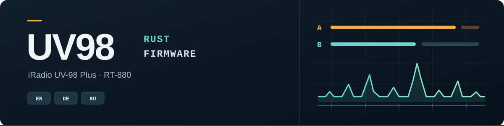
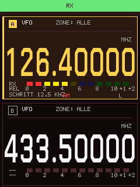
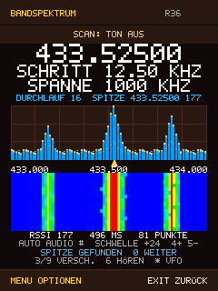
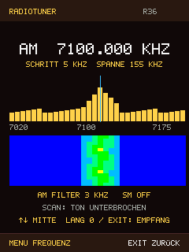
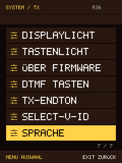

# UV98 Rust

**Rust-Firmware und Windows-CPS für die Funkgeräteplattform iRadio UV-98 Plus / RT-880.**

Unabhängige A/B-Einstellungen, ein farbiges Spektrum, Kurzwellenfunktionen und verfügbarer Quellcode.

[English](README.md) · **Deutsch** · [Русский](README.ru.md)

[**Firmware-BIN**](https://github.com/YaziAranea/uv98-rust/releases/download/r36/UV98-r36.bin) · [**Firmware und CPS**](https://github.com/YaziAranea/uv98-rust/releases/download/r36/UV98-r36-2026-11-16.zip) · [**Hier beginnen: Sicherung und Installation**](docs/GETTING-STARTED.de.md) · [Versionshinweise](https://github.com/YaziAranea/uv98-rust/releases/tag/r36)

> **Experimentelle Firmware für das untersuchte AT32F423-Platinenprofil.** R36 ist eine Vorlage: Vor dem Flashen mit CPS ein persönliches Image aus der geprüften NOR-Sicherung des eigenen Geräts erstellen. Dabei wird das Image an die eigenen Kalibrierungen gebunden; die Werksdaten werden nicht ersetzt. Eine ähnliche Modellbezeichnung belegt keine Platinenkompatibilität. Zuerst die [Sicherungs- und Vorbereitungsanleitung](docs/GETTING-STARTED.de.md#4-kompatibilität-vor-dem-flashen-prüfen) lesen.

## Ein Blick auf die Oberfläche

<table>
<tr>
<td align="center"> <b>Kanäle und VFOs A/B</b></td>
<td align="center"> <b>Spektrum und Wasserfall</b></td>
</tr>
<tr>
<td align="center"> <b>Kurzwellenfunktionen</b></td>
<td align="center"> <b>Deutsch · English · Русский</b></td>
</tr>
</table>

*Diese UI-Simulationen verwenden denselben Rust-Renderer wie das Funkgerät. Signale und Messwerte in den Abbildungen sind simuliert; sie sind keine HF-Messungen.*

## Funktionen

| Bereich | Enthaltene Funktionen |
|---|---|
| Funkbetrieb | Unabhängige Kanal-/VFO-Einstellungen für A/B, Zonen, Relaisablage, CTCSS/DCS-Anzeigen, segmentierte S-Meter und belegbare Tasten. |
| Signalsuche | Frequenzsuchlauf, Spektrumcursor und Verschieben des Frequenzfensters, Abhören eines Peaks und farbiger Wasserfall. |
| Kurzwelle | Si4732 mit AM/USB/LSB/CW-Bedienung, Band- und Schrittwahl, sequenziellem RSSI-Wasserfall, AM-Filtern und Soft Mute. |
| Signalisierung | DTMF über die Tastatur bei gedrückter PTT; fünfstellige ZVEI1-/CCIR-Kennung am Sendeende. |
| Navigation | GPS-Positionsverarbeitung und manuell ausgelöste APRS-Positionsbake über das unterstützte C-BUS-Modem. |
| Windows-CPS | Kanal- und Zonenbearbeitung, Kalibrierungs-/NOR-Sicherungen, GPS/APRS-Dateieinstellungen, BIN-Prüfung und Flashen über den originalen Bootloader. |
| Sprachen | Dokumentation und wählbare Funkgeräteoberfläche auf Deutsch, Englisch und Russisch. Eigene Kanalnamen bleiben unverändert. |

Der originale Modus „800 MHz“ beginnt bei **840 MHz**; die Vorgabe wählt 850,000 MHz. Die CB-Vorgabe liegt bei 27,135 MHz. CB-AM ist nur Empfang; AM-Senden wurde nicht ergänzt.

## Zuerst sichern

1. Die Originalfirmware beibehalten und die ursprüngliche `.880dmf`-/`.98pdmf`-Datei des eigenen Geräts sichern.
2. Mit unserer CPS **Kalibrierung**, **4 MiB NOR** sowie **Einstellungs-/Kanalsektionen** lesen. Jeder Vorgang liest zweimal und vergleicht die Daten.
3. Die vollständigen Sicherungsordner und eine passende originale Wiederherstellungsdatei an zwei Orten aufbewahren. Das öffentliche Paket enthält keine Herstellerfirmware.
4. Die Platinenkompatibilität prüfen und anschließend in CPS ein persönliches R36-Image aus der geprüften NOR-Sicherung erstellen. Dafür wird kein Rust-Compiler benötigt.

Die [Schritt-für-Schritt-Anleitung](docs/GETTING-STARTED.de.md) nennt die CPS-Schaltflächen, erwarteten Dateien, Prüfkriterien und den Rückweg. **Der 4-MiB-NOR-Dump enthält weder MCU-Firmware noch Bootloader.**

## Aktuelle Grenzen

R33 ist die vom Besitzer akzeptierte Ausgangsversion. Neuere Kandidaten und ihre Prüfungen stehen in den [Versionshinweisen](https://github.com/YaziAranea/uv98-rust/releases). Ein erfolgreicher Build oder ein simuliertes Bild bestätigt keinen Empfangs- oder Sendetest am Gerät.

- Dual Watch hört A/B abwechselnd ab. Gleichzeitige Audiowiedergabe beider BK4819-Empfänger ist nicht implementiert.
- Der KW-Wasserfall stimmt den einzigen Si4732 nacheinander ab und unterbricht dabei die Audiowiedergabe. Er ist keine FFT.
- APRS sendet derzeit manuell. Eine APRS-Empfangsansicht, automatische Baken und das alternative GPIO-Modem sind noch nicht fertig.
- AM-Filter und Soft Mute sind vorhanden; allgemeine Sprachrauschunterdrückung NR/NB für den Haupt-BK4819 ist nicht implementiert.
- Die Funkgeräteeinstellungen einschließlich der Sprache liegen derzeit im RAM und gehen beim Ausschalten verloren. Der CPS-Dateieditor ist noch kein USB-Schreibprotokoll für Einstellungen der Rust-Firmware.

## Quellcode und Entwicklung

| Verzeichnis | Inhalt |
|---|---|
| [`firmware-diagnostic/`](firmware-diagnostic/) | Ausführbare Firmware und Hauptschleife. |
| [`crates/`](crates/) | Treiber, Kalibrierungsauswertung, HF-Laufzeit, UI und Signalisierung. |
| [`apps/cps/`](apps/cps/) | Quellcode der Windows-CPS. |
| [`apps/handheld-image-sim/`](apps/handheld-image-sim/) | Bildschirmsimulator mit gemeinsamem Renderer. |
| [`research/`](research/) | Hardwarebelege und Protokollanalysen. |

[Build-Anleitung](BUILDING.md) · [Mitmachen](CONTRIBUTING.md) · [Projektübergabe](HANDOFF-R36.md) · [Anforderungen und Beobachtungen](FEATURES-NEXT-RU.txt) · [Private Eingabedaten](PRIVATE-INPUTS.md)

Persönliche Kalibrierungsblöcke, NOR-Dumps und Codeplugs gehören nicht ins Repository. Einige Prüfungen benötigen originale private Testdaten; Einzelheiten stehen in der Build-Anleitung. Eigener Projektcode und Dokumentation stehen unter der [MIT-Lizenz](LICENSE); fremde Dateien behalten ihre [eigenen Lizenzen und Herkunftsangaben](THIRD-PARTY-NOTICES.md).

Für einen nachvollziehbaren Fehlerbericht bitte Version und BIN-Hash, Geräte-/Platineninformationen, genaue Schritte sowie erwartetes und tatsächliches Verhalten angeben. Ein Foto des betroffenen Bildschirms hilft. Keine vollständigen NOR-Dumps, privaten Codeplugs oder Standortprotokolle in öffentliche Issues hochladen.
