# UV98 Rust

> **PRE-ALPHA — experimentelle Firmware und CPS.** Das Projekt befindet sich in einem sehr frühen Stadium, noch vor einer Alpha-Version. Funktionen können ausfallen; die Installation kann das Funkgerät unbrauchbar machen. Installation und Nutzung erfolgen vollständig auf eigenes Risiko. Die Software wird im vorliegenden Zustand ohne Gewährleistung bereitgestellt; die Autoren übernehmen nach Maßgabe der Lizenz keine Haftung für Schäden oder Verluste. Vor einer Installation die Lizenz sowie die Anleitungen zur Sicherung und Wiederherstellung lesen.

**Rust-Firmware und Windows-CPS für die Funkgeräteplattform iRadio UV-98 Plus / RT-880.**

Unabhängige A/B-Einstellungen, ein farbiges Spektrum, Kurzwellenfunktionen und verfügbarer Quellcode.

[English](README.md) · **Deutsch** · [Русский](README.ru.md)

[**R43.1-Version**](https://github.com/YaziAranea/RT880-UV98-Rust-Firmware/releases/tag/r43.1) · [**Hier beginnen — Sicherung und Installation**](docs/GETTING-STARTED.de.md)

[**CPS 0.8.0 für Windows (ZIP)**](https://github.com/YaziAranea/RT880-UV98-Rust-Firmware/releases/download/r43.1/UV98-CPS-0.8.0.zip) · R43.1-BIN [Русский](https://github.com/YaziAranea/RT880-UV98-Rust-Firmware/releases/download/r43.1/UV98-r43.1-ru.bin) · [English](https://github.com/YaziAranea/RT880-UV98-Rust-Firmware/releases/download/r43.1/UV98-r43.1-en.bin) · [Deutsch](https://github.com/YaziAranea/RT880-UV98-Rust-Firmware/releases/download/r43.1/UV98-r43.1-de.bin)

> **Experimentelle Firmware für das untersuchte AT32F423-Platinenprofil.** Zuerst die Platinenkompatibilität prüfen. Vor dem Flashen mit CPS ein persönliches R43.1-Image aus der geprüften NOR-Sicherung des eigenen Geräts erstellen. CPS bindet das Image an die eigenen Werkskalibrierungen. [Sicherungs- und Vorbereitungsanleitung](docs/GETTING-STARTED.de.md#4-kompatibilität-vor-dem-flashen-prüfen)

R43.1 prüft eine einzelne instabile PTT-Flanke erneut und zeichnet den bestätigten TX-Rahmen zuerst. R43 bringt temporäres Überspringen beim Scan, eine TX-Frequenzvorschau und Empfangsvorrang nach PTT. [Änderungen und Gerätetest (Russisch)](R43.1-NOTES-RU.txt).

## Windows-CPS 0.8.0

Wählen Sie in der Symbolleiste unter **Язык / Language / Sprache** zwischen **Русский**, **English** und **Deutsch**. Alle acht Reiter und bereits angezeigte Statusmeldungen wechseln sofort die Sprache. Ungespeicherte Änderungen bleiben erhalten. CPS speichert die Sprachwahl im Windows-Benutzerprofil. Titel und Filter der Dateidialoge folgen der CPS-Sprache. Die Standardschaltflächen folgen der Windows-Sprache.

Unter **Firmware → BIN auswählen…** lässt sich eine kompatible Anwendungs-BIN mit Kalibrierprofil direkt öffnen. CPS prüft Struktur und Dateiintegrität. Herkunft der Version und Platinenrevision separat prüfen. Die Personalisierung speichert die persönliche BIN, eine Kopie der Quell-BIN und einen Katalog mit Herkunftsdaten. [CPS-Quellcode in R41](https://github.com/YaziAranea/RT880-UV98-Rust-Firmware/tree/r41/apps/cps)

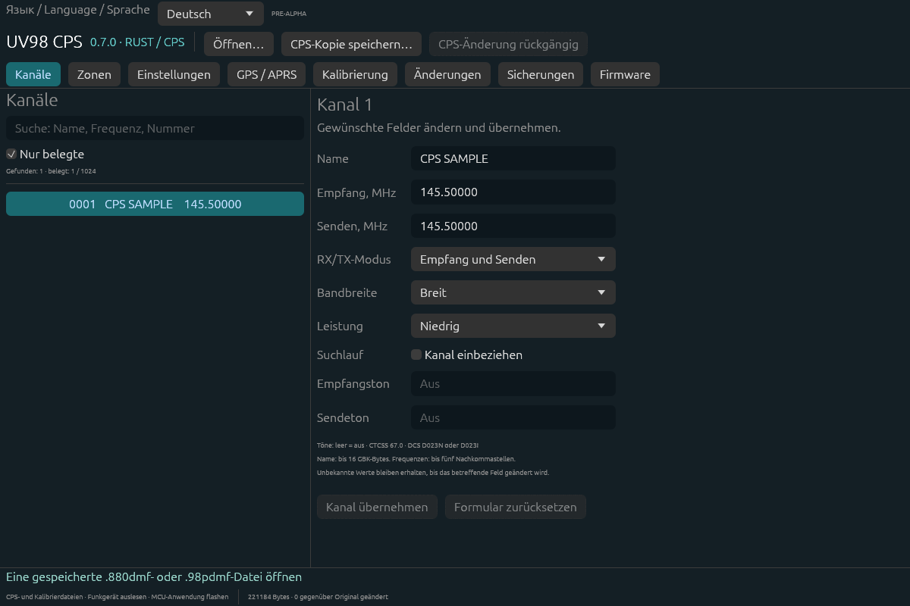

*Historische Ansicht der CPS 0.7.0, mit egui und simulierten Daten gerendert.*

## Ein Blick auf die Oberfläche

<table>
<tr>
<td align="center">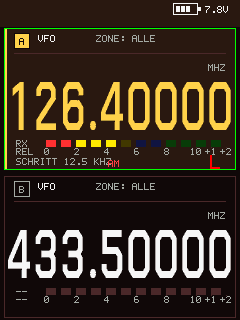 <b>Kanäle und VFOs A/B</b></td>
<td align="center">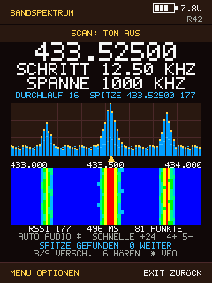 <b>Spektrum und Wasserfall</b></td>
</tr>
<tr>
<td align="center">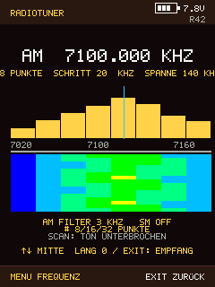 <b>Kurzwellenfunktionen</b></td>
<td align="center">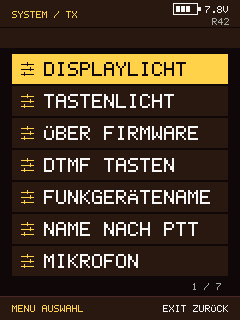 <b>Deutsches Menü in R42</b></td>
</tr>
<tr>
<td align="center">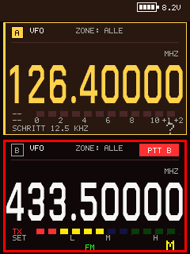 <b>PTT B bei Auswahl von A</b></td>
<td align="center">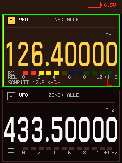 <b>Niedriger Akkustand</b></td>
</tr>
<tr>
<td align="center">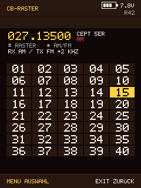 <b>CB-Kanalraster</b></td>
<td align="center">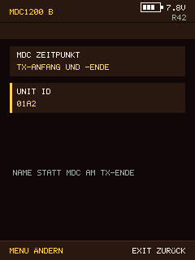 <b>MDC1200</b></td>
</tr>
<tr>
<td align="center">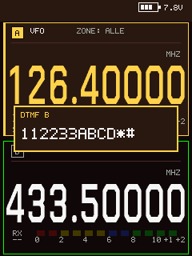 <b>DTMF-Empfang</b></td>
<td align="center">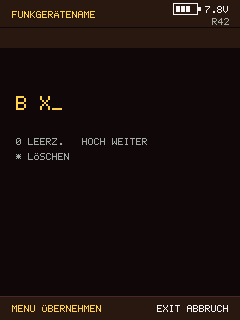 <b>Funkgerätename eingeben</b></td>
</tr>
<tr>
<td align="center">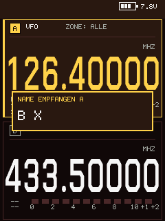 <b>Empfangener Name</b></td>
<td align="center">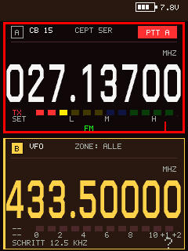 <b>CB TX über A</b></td>
</tr>
</table>

*R42-Bildschirmansichten aus dem Rust-Renderer. Signale und Messwerte sind simuliert.*

## Funktionen in R42

- **Funkgerätename nach PTT.** Unter **SYSTEM / TX** den **FUNKGERÄTENAME** eingeben und **NAME NACH PTT** einschalten. Der Name umfasst bis zu 16 lateinische Großbuchstaben, Ziffern und Leerzeichen. Bei aktivierter Option sendet das Gerät den Namen im Roger-Format der Originalfirmware RT880 1.16. Name und Schalter werden im internen Flash gespeichert. Beide Werte nach dem Aus- und Einschalten prüfen. Nach einem vollständigen Firmware-Update ist das interne Journal leer, und beim Start werden gültige Originaleinstellungen geladen. [Name eingeben und speichern](docs/GETTING-STARTED.de.md#funkgerätename-nach-ptt)
- **Leistungsanzeige.** Ein großes rotes **L**, gelbes **M** oder grünes **H** zeigt die gewählte Leistungsstufe des sendenden VFOs, auch wenn B sendet und A ausgewählt ist.

- **CB-Kanalraster.** Für VFO A stehen 40 Kanäle zur Wahl. Beim ersten Öffnen ist Kanal 15 AM auf 27,135 MHz im CEPT-Raster ausgewählt. Mit `#` zum 0er-Raster wechseln. Eine lange Zifferntaste kann das Raster öffnen. Dort EXIT gedrückt halten, um die vorherige Einstellung von A wiederherzustellen. Im CB-Raster von VFO A empfängt AM auf der Kanalfrequenz. Beim Drücken der PTT sendet das Gerät experimentell in Schmalband-FM 2 kHz höher. Auf CEPT-Kanal 15 liegt RX bei 27,135 MHz und TX bei 27,137 MHz. [CB-Bedienung](docs/GETTING-STARTED.de.md#cb-kanalraster)
- **Menü und A/B-Anzeige.** Der ausgewählte Menüpunkt ist flächig hinterlegt. Ein grüner Rahmen markiert das empfangende A/B-Feld. Beim Senden hat der rote Rahmen Vorrang. Der obere RX-Streifen entfällt.
- **DTMF-Empfang.** Beim normalen FM-Empfang mit geöffnetem Audioweg zeigt der Startbildschirm bis zu 16 BK4819-DTMF-Zeichen an. Das Fenster schließt drei Sekunden nach dem letzten Zeichen. In AM, Spektrum, Kurzwelle und Crossband bleibt der Decoder aus. DTMF über die Tastatur bei gedrückter PTT bleibt verfügbar. Select V, ZVEI und CCIR wurden entfernt.
- **Numerisches MDC1200.** Für A und B sind die 16-Bit-PTT-ID und der Sendezeitpunkt getrennt einstellbar. Bei aktivierter Namensübertragung belegt der Name das Sendeende. Die numerische ID am Sendeanfang folgt ihrer eigenen Einstellung. [Numerisches MDC1200 einstellen](docs/GETTING-STARTED.de.md#numerisches-mdc1200)
- **Kurzwellen-AM.** Beim Hören über Si4732 bleibt die Frequenz beim Wechsel des 6-, 3- oder 1-kHz-Filters und von Soft Mute erhalten. Der Wasserfall durchläuft 8, 16 oder 32 Frequenzen (Standard: 8; kurze #-Taste im Überblick) und zeichnet geänderte Zeilen neu.
- **Empfang nach PTT.** Nach dem Loslassen der PTT hat das Einrichten des Empfangs Vorrang. Ob dadurch eine kurze Relaisantwort vollständig zu hören ist, muss am Funkgerät geprüft werden.

[R42-Hinweise (Russisch)](R42-NOTES-RU.txt) · [PA5-Test mit separater RX-only-Firmware (Russisch)](research/r42/PA5-TEST-RU.txt)

## Funktionen

| Bereich | Enthaltene Funktionen |
|---|---|
| Funkbetrieb | Unabhängige Kanal-/VFO-Einstellungen für A/B, Zonen, Relaisablage, CTCSS/DCS-Anzeigen, segmentierte S-Meter und belegbare Tasten. |
| Signalsuche | Frequenzsuchlauf, Spektrumcursor und Verschieben des Frequenzfensters, Abhören eines Peaks und farbiger Wasserfall. |
| Kurzwelle | Si4732 mit AM/USB/LSB/CW-Bedienung, Band- und Schrittwahl, sequenziellem RSSI-Wasserfall, AM-Filtern und Soft Mute. |
| Signalisierung | Funkgerätename nach PTT, numerische MDC1200-PTT-ID, DTMF-Fenster beim FM-Empfang und Tastatur-DTMF bei gedrückter PTT. |
| Navigation | GPS-Positionsverarbeitung und manuell ausgelöste APRS-Positionsbake über das unterstützte C-BUS-Modem. |
| Windows-CPS | Kanal- und Zonenbearbeitung, Kalibrierungs-/NOR-Sicherungen, GPS/APRS-Dateieinstellungen, BIN-Prüfung und Flashen über den originalen Bootloader. |
| Sprachen | Separate Firmware-BINs für RU, EN und DE. Die Sprache wird vor dem Flashen gewählt. CPS besitzt eine eigene Sprachauswahl. |

Der originale Modus „800 MHz“ beginnt bei **840 MHz**. Die Vorgabe wählt 850,000 MHz.

## Zuerst sichern

1. Die Originalfirmware beibehalten und die ursprüngliche `.880dmf`-/`.98pdmf`-Datei des eigenen Geräts sichern.
2. Mit unserer CPS **Kalibrierung**, **4 MiB NOR** sowie **Einstellungs-/Kanalsektionen** lesen. Jeder Vorgang liest zweimal und vergleicht die Daten.
3. Die vollständigen Sicherungsordner und eine passende originale Wiederherstellungsdatei an zwei Orten aufbewahren. Das öffentliche Paket enthält keine Herstellerfirmware.
4. Die Platinenkompatibilität prüfen und anschließend in CPS ein persönliches R43.1-Image aus der geprüften NOR-Sicherung erstellen. Dafür wird kein Rust-Compiler benötigt.

Die [Schritt-für-Schritt-Anleitung](docs/GETTING-STARTED.de.md) nennt die CPS-Schaltflächen, erwarteten Dateien, Prüfkriterien und den Rückweg. **Der 4-MiB-NOR-Dump enthält weder MCU-Firmware noch Bootloader.**

## Aktuelle Grenzen

Für R42 stehen Gerätetests zur Namensübertragung und Speicherung über das Ausschalten hinweg, zu Anzeigezeiten, Empfang nach PTT, DTMF-Dekodierung und KW-Filterwechsel aus.

- Dual Watch hört A/B abwechselnd ab. Gleichzeitige Audiowiedergabe beider BK4819-Empfänger ist nicht implementiert.
- Der KW-Wasserfall stimmt den einzigen Si4732 nacheinander ab und unterbricht dabei die Audiowiedergabe. Er ist keine FFT.
- APRS sendet derzeit manuell. Eine APRS-Empfangsansicht, automatische Baken und das alternative GPIO-Modem sind noch nicht fertig.
- AM-Filter und Soft Mute sind vorhanden; allgemeine Sprachrauschunterdrückung NR/NB für den Haupt-BK4819 ist nicht implementiert.
- Name, PTT-Namensschalter und Mikrofonverstärkung liegen im internen Journal. Andere Änderungen am Funkgerät bleiben bis zum Ausschalten im RAM. Die geflashte BIN legt die Anzeigesprache fest.

## Quellcode und Entwicklung

| Verzeichnis | Inhalt |
|---|---|
| [`firmware-diagnostic/`](firmware-diagnostic/) | Ausführbare Firmware und Hauptschleife. |
| [`crates/`](crates/) | Treiber, Kalibrierungsauswertung, HF-Laufzeit, UI und Signalisierung. |
| [`apps/cps/`](apps/cps/) | Quellcode der Windows-CPS. |
| [`apps/handheld-image-sim/`](apps/handheld-image-sim/) | Bildschirmsimulator mit gemeinsamem Renderer. |
| [`research/`](research/) | Hardwarebelege und Protokollanalysen. |

[Build-Anleitung](BUILDING.md) · [Mitmachen](CONTRIBUTING.md) · [Projektübergabe nach R37](HANDOFF-R37.md) · [Anforderungen und Beobachtungen](FEATURES-NEXT-RU.txt) · [Funktionsvorschläge (Russisch)](docs/NEXT-FEATURES.ru.md) · [Private Eingabedaten](PRIVATE-INPUTS.md)

Persönliche Kalibrierungsblöcke, NOR-Dumps und Codeplugs gehören nicht ins Repository. Einige Prüfungen benötigen originale private Testdaten; Einzelheiten stehen in der Build-Anleitung. Eigener Projektcode und Dokumentation stehen unter der [MIT-Lizenz](LICENSE); fremde Dateien behalten ihre [eigenen Lizenzen und Herkunftsangaben](THIRD-PARTY-NOTICES.md).

Für einen nachvollziehbaren Fehlerbericht bitte Version und BIN-Hash, Geräte-/Platineninformationen, genaue Schritte sowie erwartetes und tatsächliches Verhalten angeben. Ein Foto des betroffenen Bildschirms hilft. Keine vollständigen NOR-Dumps, privaten Codeplugs oder Standortprotokolle in öffentliche Issues hochladen.
