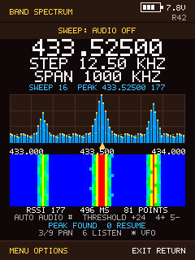
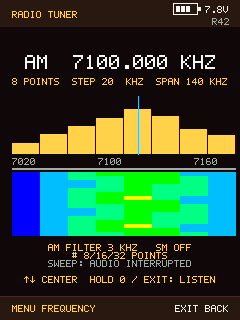
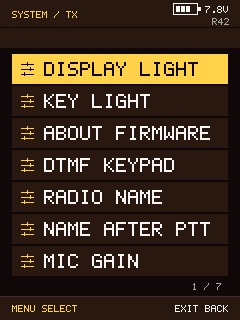
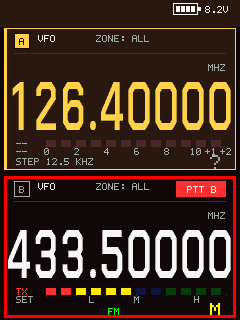
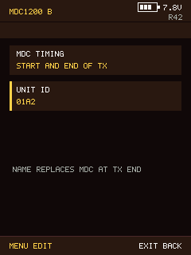
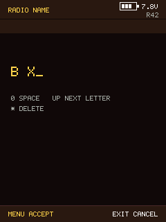
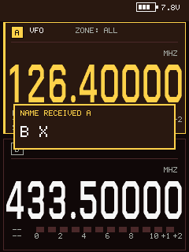
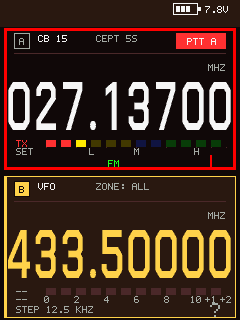

# Radtel RT-880 / iRadio UV-98 Plus — Rust Firmware

> **PRE-ALPHA — experimental firmware and CPS.** This project is at a very early stage, before alpha. Features may fail; installation can leave the radio unusable. Install and use entirely at your own risk. The software is provided as is, without warranty; the authors disclaim liability for damage or loss under the terms of the license. Read the license and backup/recovery instructions before deciding to install.

**Open-source Rust firmware and Windows CPS for Radtel RT-880 (RT880) / iRadio UV-98 Plus radio platform.**

Independent A/B operation, a colour spectrum display, shortwave tools and access to the source.

**English** · [Deutsch](README.de.md) · [Русский](README.ru.md)

[**R53 release**](https://github.com/YaziAranea/RT880-UV98-Rust-Firmware/releases/tag/r53) · [**Start here — backup and installation**](docs/GETTING-STARTED.en.md)

[**CPS 0.8.0 for Windows (ZIP)**](https://github.com/YaziAranea/RT880-UV98-Rust-Firmware/releases/download/r53/UV98-CPS-0.8.0.zip) · R53 BIN [Русский](https://github.com/YaziAranea/RT880-UV98-Rust-Firmware/releases/download/r53/UV98-r53-ru.bin) · [English](https://github.com/YaziAranea/RT880-UV98-Rust-Firmware/releases/download/r53/UV98-r53-en.bin) · [Deutsch](https://github.com/YaziAranea/RT880-UV98-Rust-Firmware/releases/download/r53/UV98-r53-de.bin)

> **Experimental firmware for the investigated AT32F423 board profile.** Verify board compatibility. Use CPS to prepare a personal R53 image from your radio's verified NOR backup before flashing. CPS binds the image to your factory calibration. [Backup and preparation guide](docs/GETTING-STARTED.en.md#4-check-compatibility-before-flashing)

R53 adds compact scan and menu modules. It frees 3,540 bytes of Flash in RU and EN and 3,536 in DE compared with R52. [Changes, downloads and offline validation](RELEASE-NOTES-R53.md).

## Windows CPS 0.8.0

Use **Язык / Language / Sprache** in the toolbar to select **Русский**, **English** or **Deutsch**. All eight tabs and existing status messages switch immediately. Unsaved edits stay in place, and CPS remembers the selection in your Windows user profile. File dialog titles and filters follow CPS. Standard dialog buttons follow Windows.

In **Firmware → Select BIN…**, open a compatible application BIN with a calibration profile directly. CPS checks structure and file integrity. Verify the release source and your board revision separately. Personalization saves the personal BIN, a copy of the source BIN and a catalog with recorded provenance. [CPS source in R41](https://github.com/YaziAranea/RT880-UV98-Rust-Firmware/tree/r41/apps/cps)

*Historical CPS 0.7.0 render from egui with simulated data.*

## On the screen

<table>
<tr>
<td align="center"> <b>A/B channels and VFOs</b></td>
<td align="center"> <b>Spectrum and waterfall</b></td>
</tr>
<tr>
<td align="center"> <b>Shortwave tools</b></td>
<td align="center"> <b>English menu in R42</b></td>
</tr>
<tr>
<td align="center"> <b>PTT B with A selected</b></td>
<td align="center"> <b>Low battery</b></td>
</tr>
<tr>
<td align="center"> <b>CB grid</b></td>
<td align="center"> <b>MDC1200</b></td>
</tr>
<tr>
<td align="center"> <b>Incoming DTMF</b></td>
<td align="center"> <b>Radio-name entry</b></td>
</tr>
<tr>
<td align="center"> <b>Received name</b></td>
<td align="center"> <b>CB TX on A</b></td>
</tr>
</table>

*R42 screenshots from the Rust renderer. Signals and readings are simulated.*

## R42 features

- **Radio name after PTT.** Set **RADIO NAME** and **NAME AFTER PTT** in **SYSTEM / TX**. The name uses up to 16 uppercase Latin letters, digits and spaces. The radio sends it in the stock RT880 1.16 Roger format when enabled. These settings are stored in internal Flash; verify them after power cycling. A full firmware update clears the internal journal, and startup then loads usable stock settings. [Name entry and saving](docs/GETTING-STARTED.en.md#radio-name-after-ptt)
- **Power indicator.** A large red **L**, yellow **M** or green **H** indicates the configured power of the transmitting slot, including B while A is selected.

- **CB grid.** The 40-channel CEPT grid for VFO A opens on channel 15 AM at 27.135 MHz on first use. Use `#` for the zero-ending frequencies. Assign a long digit to open the grid. Hold EXIT on the grid to restore the previous A context. In the CB grid on A, AM receives on the channel frequency. PTT uses experimental narrow FM 2 kHz higher. On CEPT channel 15, RX is 27.135 MHz and TX is 27.137 MHz. [CB controls](docs/GETTING-STARTED.en.md#cb-grid)
- **Menu and A/B status.** A solid fill highlights the selected menu item. A green outline marks the receiving A/B slot. The transmitting slot has a red outline, which takes priority. RX no longer uses the top status strip.
- **DTMF reception.** On ordinary BK4819 FM reception with audio open, the home-screen popup keeps up to 16 symbols for three seconds after the last detected symbol. AM, spectrum, shortwave and crossband modes do not use this decoder. Keypad DTMF during PTT is still available. Select V, ZVEI and CCIR were removed.
- **Numeric MDC1200.** Each slot has its own 16-bit PTT ID and timing. When name transmission is enabled, the name takes the end-of-TX slot. Numeric start-of-TX transmission follows its own setting. [Numeric MDC1200 controls](docs/GETTING-STARTED.en.md#numeric-mdc1200)
- **Shortwave AM.** During listening on Si4732, changing the 6, 3 or 1 kHz filter or soft mute keeps the current frequency. The waterfall steps through 8, 16 or 32 frequencies (8 by default; short # in scope changes resolution) and redraws changed rows.
- **RX after PTT.** The firmware prioritizes receiver setup after PTT release. Pickup of a short repeater reply still needs testing on the radio.

[R42 notes (Russian)](R42-NOTES-RU.txt) · [Separate RX-only PA5 audio test guide (Russian)](research/r42/PA5-TEST-RU.txt)

## What is included

| Area | Features |
|---|---|
| Everyday operation | Independent A/B channel or VFO contexts, zones, repeater shift, CTCSS/DCS indications, segmented signal meters and assignable keys. |
| Finding signals | Frequency scanning, priority zone scanning, temporary channel skip, CTCSS/DCS receive-tone search and a colour spectrum waterfall. |
| Shortwave | Si4732 receiver, AM/USB/LSB/CW controls, band and step selection, sequential RSSI waterfall, AM filters and soft mute. |
| Signalling | Radio name after PTT, numeric MDC1200 PTT ID, incoming FM DTMF, three DTMF memories and 1750 Hz tone. |
| Navigation | GPS, APRS receive history, manual and operator-enabled automatic GPS beacons on supported C-BUS/CMX868 boards. |
| Windows CPS | Channel/zone editing, calibration and NOR backups, GPS/APRS file settings, image validation and flashing through the stock loader. |
| Languages | Separate RU, EN and DE firmware BINs. Choose the desired language before flashing. CPS has its own language selector. |

The stock “800 MHz” mode starts at **840 MHz**. The preset uses 850.000 MHz.

## Start with a backup

1. Keep the radio on its stock firmware and save its original `.880dmf` / `.98pdmf` file.
2. Use our CPS to save **calibration**, **4 MiB NOR** and **settings/channel sections**. Each operation reads twice and compares the results.
3. Keep the complete snapshot folders and a matching factory recovery file in two places. The public package does not include the manufacturer's firmware.
4. Check board compatibility, then prepare your personal R53 image in CPS from the verified NOR snapshot. No Rust compiler is needed for this step.

The [file checklist and step-by-step guide](docs/GETTING-STARTED.en.md) names every CPS button and expected file. **The 4 MiB NOR backup is not an MCU firmware or bootloader dump.**

## Current limits

On one RT-880, the operator confirmed that R53 RU started, both PTT buttons worked and the repeater tail was audible. On-radio checks of zone scan and APRS remain open.

- Dual Watch alternates the receiver. Simultaneous audio from two BK4819 receivers is not implemented.
- The HF waterfall retunes one Si4732 and interrupts audio during the sweep; it is not an FFT.
- APRS reception, manual beaconing and operator-enabled automatic beaconing use the supported C-BUS/CMX868 modem.
- AM filters/soft mute are available; general-purpose voice NR/NB on the main BK4819 is not implemented.
- The internal journal stores the radio name, its PTT toggle, microphone gain and the saved A/B position. Firmware language is fixed by the BIN.

## Source and development

| Path | Purpose |
|---|---|
| [`firmware-diagnostic/`](firmware-diagnostic/) | Executable firmware and the main radio loop. |
| [`crates/`](crates/) | Drivers, calibration interpretation, RF runtime, UI and signalling. |
| [`apps/cps/`](apps/cps/) | Windows CPS source. |
| [`apps/handheld-image-sim/`](apps/handheld-image-sim/) | Screen simulator using the shared renderer. |
| [`research/`](research/) | Hardware evidence and protocol notes. |

[Build instructions](BUILDING.md) · [Contributing](CONTRIBUTING.md) · [R37 handoff](HANDOFF-R37.md) · [Requirements and observations](FEATURES-NEXT-RU.txt) · [Firmware modules (Russian)](docs/FIRMWARE-MODULES.ru.md) · [Private input policy](PRIVATE-INPUTS.md)

Personal calibration blocks, NOR dumps and codeplugs are excluded from the repository. Some verification uses an original private fixture; see the build instructions before attempting to reproduce it. Original project code and documentation use the [MIT licence](LICENSE); third-party files retain their [own licences and attribution](THIRD-PARTY-NOTICES.md).

For a useful issue, include the release and BIN hash, radio model/board information, exact steps, expected/actual behaviour and a photo of the relevant screen. Do not attach your full NOR, private codeplug or personal location logs to a public issue.
