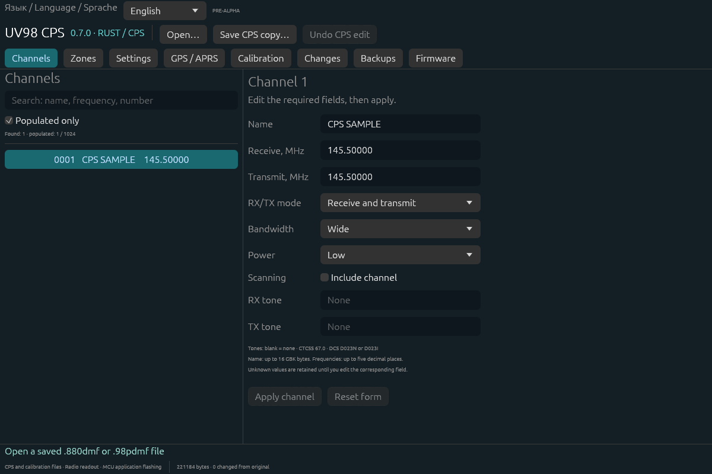
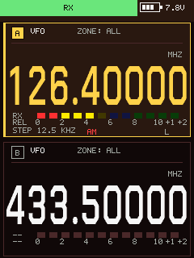
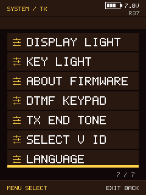
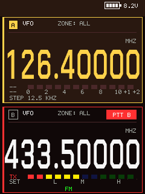
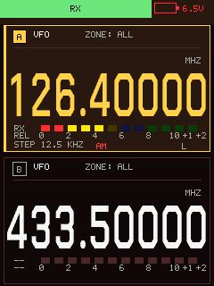

# UV98 Rust

> **PRE-ALPHA — experimental firmware and CPS.** This project is at a very early stage, before alpha. Features may fail; installation can leave the radio unusable. Install and use entirely at your own risk. The software is provided as is, without warranty; the authors disclaim liability for damage or loss under the terms of the license. Read the license and backup/recovery instructions before deciding to install.

**Rust firmware and Windows CPS for the iRadio UV-98 Plus / RT-880 radio platform.**

Independent A/B operation, a colour spectrum display, shortwave tools and access to the source.

**English** · [Deutsch](README.de.md) · [Русский](README.ru.md)

[**Firmware BIN**](https://github.com/YaziAranea/uv98-rust/releases/download/r37/UV98-r37.bin) · [**Firmware + CPS 0.7.0**](https://github.com/YaziAranea/uv98-rust/releases/download/r37/UV98-r37-CPS-0.7.0-2026-11-16.zip) · [**Start here: backup and installation**](docs/GETTING-STARTED.en.md) · [Release notes](https://github.com/YaziAranea/uv98-rust/releases/tag/r37)

> **Experimental firmware for the investigated AT32F423 board profile.** R37 is a template: use CPS to prepare a per-radio image from your verified NOR backup before flashing. This binds the image to your own calibration; it does not replace factory data. A similar model name does not establish board compatibility. Follow the [backup and preparation guide](docs/GETTING-STARTED.en.md#4-check-compatibility-before-flashing).

## Windows CPS 0.7.0

Use **Язык / Language / Sprache** in the toolbar to select **Русский**, **English** or **Deutsch**. All eight tabs and existing status messages switch immediately. Unsaved edits stay in place, and CPS remembers the selection in your Windows user profile. File dialog titles and filters follow CPS. Standard dialog buttons follow Windows.

The kit contains the same R37 firmware BIN. Updating CPS requires no reflash. [CPS 0.7.0 source](https://github.com/YaziAranea/uv98-rust/tree/cps-v0.7.0)

*Headless render of the CPS interface from egui with simulated data.*

## On the screen

<table>
<tr>
<td align="center"> <b>A/B channels and VFOs</b></td>
<td align="center"> <b>Spectrum and waterfall</b></td>
</tr>
<tr>
<td align="center"> <b>Shortwave tools</b></td>
<td align="center"> <b>English · Deutsch · Русский</b></td>
</tr>
<tr>
<td align="center"> <b>PTT B with A selected</b></td>
<td align="center"> <b>Low battery</b></td>
</tr>
</table>

*UI simulations rendered by the same Rust renderer used on the radio. Signals and readings in these illustrations are simulated; the images are not RF measurements.*

## New in R37

- With the default bindings, the upper PTT requests A and the lower PTT requests B. The transmitting card shows TX. Pressing the lower PTT while A is selected keeps A selected and uses B's transmit frequency, TX tone and current power setting. Power is set separately for A and B in RAM and starts at LOW after power-on. The lower button's ADC mapping comes from the circuit diagram and archived readings. R37 still needs a radio test. [PTT evidence](research/r37/ptt.md)
- The battery icon shows an approximate level with up to four bars, alongside the numeric voltage (`--.-V` when unavailable). It derives from the stock ADC conversion in 0.1 V steps. Voltage accuracy and the thresholds still need a check on the radio.
- A selection change within the same menu page sends 15 LCD rows in the rendering test, down from 67, roughly 78% less pixel traffic for that action. On-radio frame rate has yet to be measured.

## What is included

| Area | Features |
|---|---|
| Everyday operation | Independent A/B channel or VFO contexts, zones, repeater shift, CTCSS/DCS indications, segmented signal meters and assignable keys. |
| Finding signals | Frequency scanning, spectrum cursor and window control, peak listening and a colour waterfall. |
| Shortwave | Si4732 receiver, AM/USB/LSB/CW controls, band and step selection, sequential RSSI waterfall, AM filters and soft mute. |
| Signalling | Keypad DTMF while holding PTT; five-digit ZVEI1/CCIR identification at the end of transmission. |
| Navigation | GPS position handling and an explicitly requested APRS position beacon through the supported C-BUS modem. |
| Windows CPS | Channel/zone editing, calibration and NOR backups, GPS/APRS file settings, image validation and flashing through the stock loader. |
| Languages | English, German and Russian documentation and selectable radio UI. Channel names remain the user's own text. |

The stock “800 MHz” mode starts at **840 MHz**; the preset uses 850.000 MHz. CB uses a 27.135 MHz preset. CB AM is receive-only; AM transmission has not been added.

## Start with a backup

1. Keep the radio on its stock firmware and save its original `.880dmf` / `.98pdmf` file.
2. Use our CPS to save **calibration**, **4 MiB NOR** and **settings/channel sections**. Each operation reads twice and compares the results.
3. Keep the complete snapshot folders and a matching factory recovery file in two places. The public package does not include the manufacturer's firmware.
4. Check board compatibility, then prepare your personal R37 image in CPS from the verified NOR snapshot. No Rust compiler is needed for this step.

The [file checklist and step-by-step guide](docs/GETTING-STARTED.en.md) names every CPS button and expected file. **The 4 MiB NOR backup is not an MCU firmware or bootloader dump.**

## Current limits

R33 is the owner's accepted hardware baseline. R37 is awaiting on-radio verification. Build checks and simulated screens are listed in the [release notes](https://github.com/YaziAranea/uv98-rust/releases/tag/r37).

- Dual Watch alternates the receiver. Simultaneous audio from two BK4819 receivers is not implemented.
- The HF waterfall retunes one Si4732 and interrupts audio during the sweep; it is not an FFT.
- APRS is currently a manual beacon. An APRS receive UI, automatic beacons and the alternative GPIO modem remain unfinished.
- AM filters/soft mute are available; general-purpose voice NR/NB on the main BK4819 is not implemented.
- Radio settings, including the selected UI language, are currently volatile. The CPS file editor is not yet a USB settings-write protocol for the Rust firmware.

## Source and development

| Path | Purpose |
|---|---|
| [`firmware-diagnostic/`](firmware-diagnostic/) | Executable firmware and the main radio loop. |
| [`crates/`](crates/) | Drivers, calibration interpretation, RF runtime, UI and signalling. |
| [`apps/cps/`](apps/cps/) | Windows CPS source. |
| [`apps/handheld-image-sim/`](apps/handheld-image-sim/) | Screen simulator using the shared renderer. |
| [`research/`](research/) | Hardware evidence and protocol notes. |

[Build instructions](BUILDING.md) · [Contributing](CONTRIBUTING.md) · [R37 handoff](HANDOFF-R37.md) · [Requirements and observations](FEATURES-NEXT-RU.txt) · [Proposed features (Russian)](docs/NEXT-FEATURES.ru.md) · [Private input policy](PRIVATE-INPUTS.md)

Personal calibration blocks, NOR dumps and codeplugs are excluded from the repository. Some verification uses an original private fixture; see the build instructions before attempting to reproduce it. Original project code and documentation use the [MIT licence](LICENSE); third-party files retain their [own licences and attribution](THIRD-PARTY-NOTICES.md).

For a useful issue, include the release and BIN hash, radio model/board information, exact steps, expected/actual behaviour and a photo of the relevant screen. Do not attach your full NOR, private codeplug or personal location logs to a public issue.
