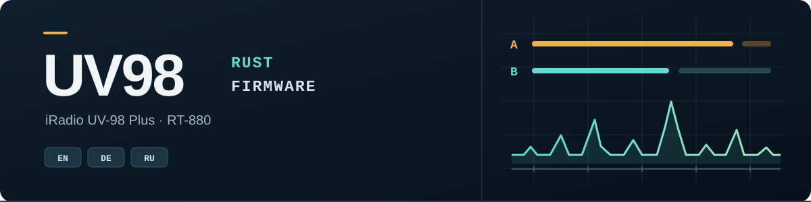
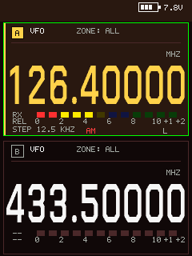
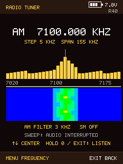
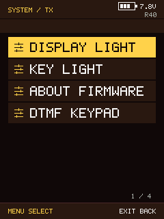
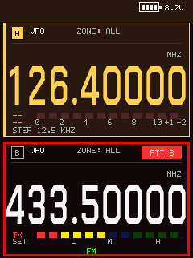
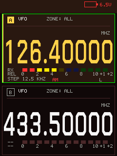
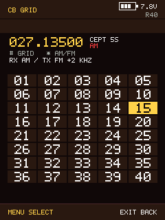
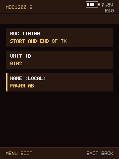
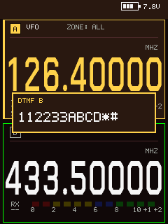
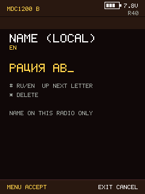

# Radtel RT-880 / iRadio UV-98 Plus — Rust Firmware

> **PRE-ALPHA — experimental firmware and CPS.** This project is at a very early stage, before alpha. Features may fail; installation can leave the radio unusable. Install and use entirely at your own risk. The software is provided as is, without warranty; the authors disclaim liability for damage or loss under the terms of the license. Read the license and backup/recovery instructions before deciding to install.

**Open-source Rust firmware and Windows CPS for Radtel RT-880 (RT880) / iRadio UV-98 Plus radio platform.**

Independent A/B operation, a colour spectrum display, shortwave tools and access to the source.

**English** · [Deutsch](README.de.md) · [Русский](README.ru.md)

[**Firmware releases and CPS**](https://github.com/YaziAranea/RT880-UV98-Rust-Firmware/releases) · [**Start here — backup and installation**](docs/GETTING-STARTED.en.md)

> **Experimental firmware for the investigated AT32F423 board profile.** Use CPS to prepare a personal R40 image from your radio's verified NOR backup before flashing. CPS binds the image to your factory calibration. Verify board compatibility before proceeding. [Backup and preparation guide](docs/GETTING-STARTED.en.md#4-check-compatibility-before-flashing)

## Windows CPS 0.7.0

Use **Язык / Language / Sprache** in the toolbar to select **Русский**, **English** or **Deutsch**. All eight tabs and existing status messages switch immediately. Unsaved edits stay in place, and CPS remembers the selection in your Windows user profile. File dialog titles and filters follow CPS. Standard dialog buttons follow Windows.

The R40 kit bundles the released CPS 0.7.0 build. [CPS 0.7.0 source](https://github.com/YaziAranea/RT880-UV98-Rust-Firmware/tree/cps-v0.7.0)

*Headless render of the CPS interface from egui with simulated data.*

## On the screen

<table>
<tr>
<td align="center"> <b>A/B channels and VFOs</b></td>
<td align="center"> <b>Spectrum and waterfall</b></td>
</tr>
<tr>
<td align="center"> <b>Shortwave tools</b></td>
<td align="center"> <b>English menu in R40</b></td>
</tr>
<tr>
<td align="center"> <b>PTT B with A selected</b></td>
<td align="center"> <b>Low battery</b></td>
</tr>
<tr>
<td align="center"> <b>CB grid</b></td>
<td align="center"> <b>MDC1200</b></td>
</tr>
<tr>
<td align="center"> <b>Incoming DTMF</b></td>
<td align="center"> <b>Local name entry</b></td>
</tr>
</table>

*R40 screenshots from the Rust renderer. Signals and readings are simulated.*

## R40 features

- **CB grid.** The 40-channel CEPT grid for VFO A opens on channel 15 AM at 27.135 MHz on first use. Use `#` for the zero-ending frequencies. Assign a long digit to open the grid. Hold EXIT on the grid to restore the previous A context. In the CB grid on A, AM receives on the channel frequency. PTT uses experimental narrow FM 2 kHz higher. On CEPT channel 15, RX is 27.135 MHz and TX is 27.137 MHz. [CB controls](docs/GETTING-STARTED.en.md#cb-grid)
- **Menu and A/B status.** A solid fill highlights the selected menu item. A green outline marks the receiving A/B slot. The transmitting slot has a red outline, which takes priority. RX no longer uses the top status strip.
- **DTMF reception.** On ordinary BK4819 FM reception with audio open, the home-screen popup keeps up to 16 symbols for three seconds after the last detected symbol. AM, spectrum, shortwave and crossband modes do not use this decoder. Keypad DTMF during PTT is still available. Select V, ZVEI and CCIR were removed.
- **MDC1200.** Each slot can send its own 16-bit PTT ID at the start or end of TX, or both. The local RU/EN name is a label of up to 12 characters stored in RAM. [MDC1200 and keypad controls](docs/GETTING-STARTED.en.md#mdc1200-and-local-name)
- **Shortwave AM.** During listening on Si4732, changing the 6, 3 or 1 kHz filter or soft mute keeps the current frequency and avoids restarting the tuning sequence. The waterfall still steps through frequencies.
- **RX after PTT.** The firmware prioritizes receiver setup after PTT release. Pickup of a short repeater reply still needs testing on the radio.

## What is included

| Area | Features |
|---|---|
| Everyday operation | Independent A/B channel or VFO contexts, zones, repeater shift, CTCSS/DCS indications, segmented signal meters and assignable keys. |
| Finding signals | Frequency scanning, spectrum cursor and window control, peak listening and a colour waterfall. |
| Shortwave | Si4732 receiver, AM/USB/LSB/CW controls, band and step selection, sequential RSSI waterfall, AM filters and soft mute. |
| Signalling | MDC1200 16-bit PTT ID, incoming FM DTMF popup and keypad DTMF while holding PTT. |
| Navigation | GPS position handling and an explicitly requested APRS position beacon through the supported C-BUS modem. |
| Windows CPS | Channel/zone editing, calibration and NOR backups, GPS/APRS file settings, image validation and flashing through the stock loader. |
| Languages | Separate RU, EN and DE firmware BINs. Choose the desired language before flashing. CPS 0.7.0 keeps its own language selector. |

The stock “800 MHz” mode starts at **840 MHz**. The preset uses 850.000 MHz.

## Start with a backup

1. Keep the radio on its stock firmware and save its original `.880dmf` / `.98pdmf` file.
2. Use our CPS to save **calibration**, **4 MiB NOR** and **settings/channel sections**. Each operation reads twice and compares the results.
3. Keep the complete snapshot folders and a matching factory recovery file in two places. The public package does not include the manufacturer's firmware.
4. Check board compatibility, then prepare your personal R40 image in CPS from the verified NOR snapshot. No Rust compiler is needed for this step.

The [file checklist and step-by-step guide](docs/GETTING-STARTED.en.md) names every CPS button and expected file. **The 4 MiB NOR backup is not an MCU firmware or bootloader dump.**

## Current limits

R40 still needs on-radio checks of display timing, reception after PTT, DTMF decoding, and shortwave filter changes. The build and simulator exercise the software paths.

- Dual Watch alternates the receiver. Simultaneous audio from two BK4819 receivers is not implemented.
- The HF waterfall retunes one Si4732 and interrupts audio during the sweep; it is not an FFT.
- APRS is currently a manual beacon. An APRS receive UI, automatic beacons and the alternative GPIO modem remain unfinished.
- AM filters/soft mute are available; general-purpose voice NR/NB on the main BK4819 is not implemented.
- Radio settings are volatile. The interface language is fixed by the flashed BIN. CPS edits settings files and prepares firmware images.

## Source and development

| Path | Purpose |
|---|---|
| [`firmware-diagnostic/`](firmware-diagnostic/) | Executable firmware and the main radio loop. |
| [`crates/`](crates/) | Drivers, calibration interpretation, RF runtime, UI and signalling. |
| [`apps/cps/`](apps/cps/) | Windows CPS source. |
| [`apps/handheld-image-sim/`](apps/handheld-image-sim/) | Screen simulator using the shared renderer. |
| [`research/`](research/) | Hardware evidence and protocol notes. |

[Build instructions](BUILDING.md) · [Contributing](CONTRIBUTING.md) · [R37 handoff](HANDOFF-R37.md) · [Requirements and observations](FEATURES-NEXT-RU.txt) · [Proposed features (Russian)](docs/NEXT-FEATURES.ru.md) · [Private input policy](PRIVATE-INPUTS.md)

Personal calibration blocks, NOR dumps and codeplugs are excluded from the repository. Some verification uses an original private fixture; see the build instructions before attempting to reproduce it. Original project code and documentation use the [MIT licence](LICENSE); third-party files retain their [own licences and attribution](THIRD-PARTY-NOTICES.md).

For a useful issue, include the release and BIN hash, radio model/board information, exact steps, expected/actual behaviour and a photo of the relevant screen. Do not attach your full NOR, private codeplug or personal location logs to a public issue.
