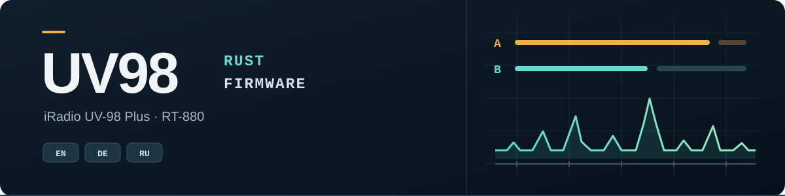

# UV98 Rust

> **ПРЕ-АЛЬФА — экспериментальная прошивка и CPS.** Проект находится на очень ранней стадии, ещё до альфа-версии. Возможны ошибки, потеря работоспособности и повреждение станции. Решение об установке и всё использование — полностью на ваш страх и риск. ПО предоставляется как есть, без гарантий; авторы не несут ответственности за ущерб или убытки в соответствии с условиями лицензии. До установки прочитайте лицензию и инструкции резервирования и возврата на сток.

**Прошивка на Rust и Windows CPS для платформы iRadio UV-98 Plus / RT-880.**

Независимые A/B, цветной спектр, инструменты КВ-приёмника и доступные исходники.

[English](README.md) · [Deutsch](README.de.md) · **Русский**

[**Выпуск R41**](https://github.com/YaziAranea/RT880-UV98-Rust-Firmware/releases/tag/r41) · [**Начать здесь — бэкап и установка**](docs/GETTING-STARTED.ru.md)

[**CPS 0.8.0 для Windows (ZIP)**](https://github.com/YaziAranea/RT880-UV98-Rust-Firmware/releases/download/r41/UV98-CPS-0.8.0.zip) · BIN R41 [Русский](https://github.com/YaziAranea/RT880-UV98-Rust-Firmware/releases/download/r41/UV98-r41-ru.bin) · [English](https://github.com/YaziAranea/RT880-UV98-Rust-Firmware/releases/download/r41/UV98-r41-en.bin) · [Deutsch](https://github.com/YaziAranea/RT880-UV98-Rust-Firmware/releases/download/r41/UV98-r41-de.bin)

> **Экспериментальная прошивка для исследованного профиля платы AT32F423.** Сначала проверьте совместимость платы. Перед записью подготовьте в CPS персональный образ R41 по проверенному NOR-бэкапу своей станции. CPS привяжет образ к вашим заводским калибровкам. [Инструкция резервирования и подготовки](docs/GETTING-STARTED.ru.md#4-проверьте-совместимость-перед-прошивкой)

## CPS 0.8.0 для Windows

В списке **Язык / Language / Sprache** на панели выберите **Русский**, **English** или **Deutsch**. Все восемь вкладок и уже показанные сообщения меняют язык сразу. Несохранённые правки остаются в формах, а выбор языка запоминается в профиле Windows. Заголовки и фильтры файловых диалогов следуют языку CPS, стандартные кнопки — языку Windows.

В разделе **«Прошивка» → «Выбрать BIN…»** можно открыть совместимый прикладной BIN с профилем калибровок отдельно. CPS проверяет структуру и целостность файла. Источник выпуска и ревизию платы проверяйте отдельно. После персонализации сохраняются личный BIN, копия исходного BIN и каталог с данными о происхождении. [Исходники CPS в R41](https://github.com/YaziAranea/RT880-UV98-Rust-Firmware/tree/r41/apps/cps)

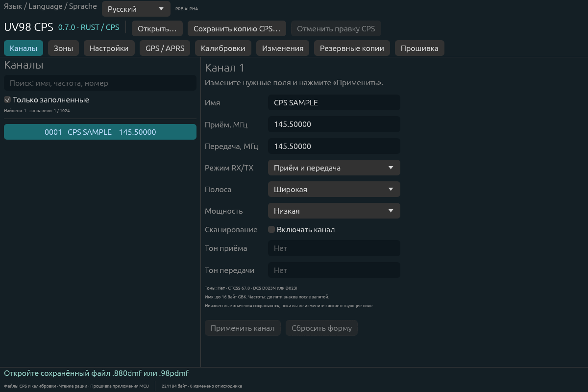

*Исторический кадр CPS 0.7.0 из egui на имитационных данных.*

## Как выглядит интерфейс

<table>
<tr>
<td align="center">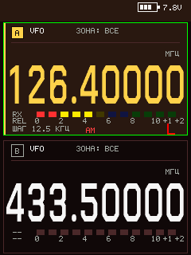 <b>Каналы и VFO A/B</b></td>
<td align="center">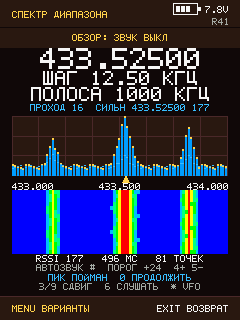 <b>Спектр и водопад</b></td>
</tr>
<tr>
<td align="center"> <b>Инструменты КВ</b></td>
<td align="center">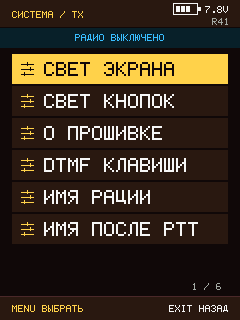 <b>Русское меню R41</b></td>
</tr>
<tr>
<td align="center">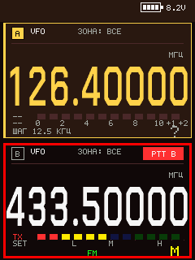 <b>PTT B при выбранной строке A</b></td>
<td align="center">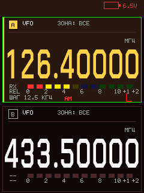 <b>Низкий заряд</b></td>
</tr>
<tr>
<td align="center">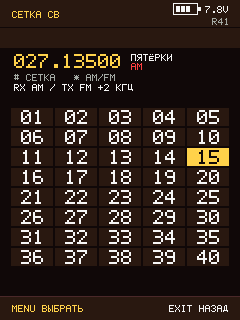 <b>Сетка CB</b></td>
<td align="center">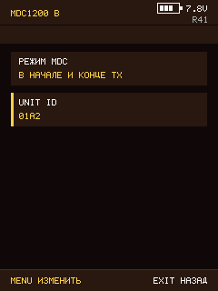 <b>MDC1200</b></td>
</tr>
<tr>
<td align="center"> <b>Входящий DTMF</b></td>
<td align="center">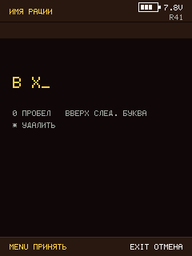 <b>Ввод имени рации</b></td>
</tr>
<tr>
<td align="center">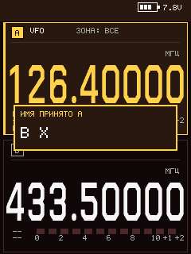 <b>Принятое имя</b></td>
<td align="center">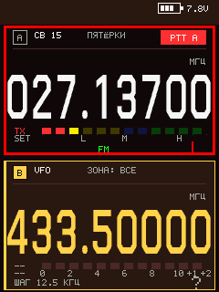 <b>CB TX по A</b></td>
</tr>
</table>

*Кадры R41 из Rust-рендерера. Сигналы и показания смоделированы.*

## Возможности R41

- **Имя рации после PTT.** В меню **СИСТЕМА / TX** задайте **ИМЯ РАЦИИ** и включите **ИМЯ ПОСЛЕ PTT**. Имя содержит до 16 латинских заглавных букв, цифр и пробелов. В эфире используется штатный формат Roger RT880 1.16. Имя и переключатель сохраняются после выключения. Полная перепрошивка очищает внутренний журнал, после чего используются допустимые значения из стока. [Ввод и сохранение имени](docs/GETTING-STARTED.ru.md#имя-рации-после-ptt)
- **Индикатор мощности.** Крупная красная **L**, жёлтая **M** или зелёная **H** показывает установленную ступень мощности передающего слота, в том числе B при выбранной строке A.

- **Сетка CB.** Для VFO A доступны 40 каналов. При первом открытии выбран 15 AM, 27,135 МГц («пятёрки»). Клавиша `#` переключает сетку на «нули». Вход можно назначить на долгую цифровую клавишу. Удержание EXIT на экране сетки возвращает прежний контекст A. В сетке CB на A режим AM принимает на частоте канала. При нажатии PTT включается экспериментальная передача узкой FM на 2 кГц выше. На канале 15 в «пятёрках» RX — 27,135 МГц, TX — 27,137 МГц. [Управление сеткой CB](docs/GETTING-STARTED.ru.md#сетка-cb)
- **Меню и индикация A/B.** Выбранный пункт меню выделяется заливкой. Зелёная рамка отмечает принимающий слот A/B, красная — передающий и имеет приоритет. Верхняя полоска RX убрана.
- **Приём DTMF.** При обычном FM-приёме с открытым звуком рация показывает до 16 символов, распознанных BK4819, на главном экране. Окно закрывается через 3 секунды после последнего символа. Декодер отключён в AM, спектре, КВ и кроссбенде. DTMF с клавиатуры при PTT сохранён. Select V, ZVEI и CCIR удалены.
- **Числовой MDC1200.** Для каждого слота отдельно задаются 16-битный PTT-ID и момент отправки. Если включена передача имени, оно занимает место числовой посылки в конце TX. Отправка числового ID в начале сохраняется по своей настройке. [Настройка числового MDC1200](docs/GETTING-STARTED.ru.md#числовой-mdc1200)
- **КВ AM.** На Si4732 смена фильтра 6, 3 или 1 кГц и soft mute при прослушивании сохраняет текущую частоту. Водопад проходит по 32 частотам и перерисовывает изменившиеся строки.
- **Приём после PTT.** После отпускания PTT настройка приёмника получает приоритет. Захват короткого ответа репитера предстоит проверить на рации.

[Заметки R41](R41-NOTES-RU.txt) · [Проверка PA5 в отдельном RX-only образе](research/r41/PA5-TEST-RU.txt)

## Что есть в проекте

| Раздел | Возможности |
|---|---|
| Повседневная работа | Независимые канальный/VFO-режимы A/B, зоны, репитерный сдвиг, индикация CTCSS/DCS, сегментные S-метры и назначаемые клавиши. |
| Поиск сигналов | Сканирование частот, курсор и перемещение окна спектра, прослушивание пика, цветной водопад. |
| КВ | Si4732, управление AM/USB/LSB/CW, выбор диапазона и шага, последовательный RSSI-водопад, AM-фильтры и soft mute. |
| Сигналинг | Имя рации после PTT, 16-битный PTT-ID MDC1200, окно входящего DTMF при FM-приёме и передача DTMF с клавиатуры при PTT. |
| Навигация | Обработка GPS-позиции и ручной APRS-маяк через поддерживаемый C-BUS модем. |
| CPS для Windows | Каналы и зоны, резервирование калибровок/NOR, настройки GPS/APRS в файле, проверка BIN и запись через штатный загрузчик. |
| Языки | Отдельные BIN прошивки RU, EN и DE. Язык выбирается перед записью. В CPS есть свой переключатель языка. |

Штатный режим «800 МГц» начинается **с 840 МГц**. Пресет выбирает 850,000 МГц.

## Сначала резервная копия

1. Оставьте стоковую прошивку и сохраните исходный `.880dmf` / `.98pdmf` своей станции.
2. Через нашу CPS считайте **калибровки**, **4 МиБ NOR** и **секции настроек/каналов**. Каждая операция читает данные дважды и сравнивает их.
3. Сохраните целые папки снимков и подходящий заводской BIN в двух местах. Публичный комплект не содержит прошивку производителя.
4. Проверьте совместимость платы, затем подготовьте в CPS персональный образ R41 по проверенному снимку NOR. Компилятор Rust для этого не нужен.

В [пошаговой инструкции](docs/GETTING-STARTED.ru.md) указаны кнопки CPS, ожидаемые файлы, проверка результата и откат. **Дамп NOR 4 МиБ не содержит прошивку MCU и загрузчик.**

## Текущие границы

Для R41 предстоит проверить на рации передачу имени и его сохранение после выключения, скорость экрана, возврат приёма после PTT, декодирование DTMF и смену КВ-фильтров.

- Dual Watch поочерёдно слушает A/B. Одновременного звука двух BK4819 нет.
- КВ-водопад перестраивает единственный Si4732 и прерывает звук на время обзора. Это не FFT.
- APRS пока ручной: приём сообщений в интерфейсе, автомаяк и альтернативный GPIO-модем не закончены.
- Есть AM-фильтры и soft mute; полноценный NR/NB голоса основного BK4819 не реализован.
- Имя рации и его переключатель сохраняются во внутреннем журнале. Остальные изменения из меню действуют до выключения. Язык интерфейса задан записанным BIN.

## Исходники и разработка

| Каталог | Содержимое |
|---|---|
| [`firmware-diagnostic/`](firmware-diagnostic/) | Исполняемая прошивка и основной цикл рации. |
| [`crates/`](crates/) | Драйверы, интерпретация калибровок, RF runtime, UI и сигналинг. |
| [`apps/cps/`](apps/cps/) | Исходники Windows CPS. |
| [`apps/handheld-image-sim/`](apps/handheld-image-sim/) | Симулятор экранов с общим рендерером. |
| [`research/`](research/) | Аппаратные основания и исследования протоколов. |

[Как собрать](BUILDING.md) · [Участие в проекте](CONTRIBUTING.md) · [Состояние проекта после R37](HANDOFF-R37.md) · [Требования и наблюдения](FEATURES-NEXT-RU.txt) · [Что добавить дальше](docs/NEXT-FEATURES.ru.md) · [Приватные входы](PRIVATE-INPUTS.md)

Личные калибровки, NOR и codeplug не публикуются. Часть проверок требует оригинального приватного fixture — это описано в инструкции сборки. Собственные код и документация проекта распространяются по [лицензии MIT](LICENSE); сторонние файлы сохраняют [свои лицензии и авторство](THIRD-PARTY-NOTICES.md).

Для сообщения об ошибке укажите выпуск и SHA BIN, модель/плату, точные действия, ожидаемый и фактический результат; приложите фото нужного экрана. Не выкладывайте в публичный issue полный NOR, личный codeplug и журналы координат.
