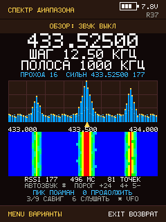
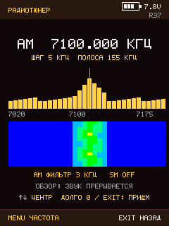
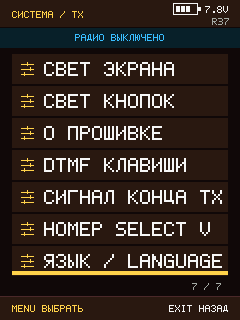
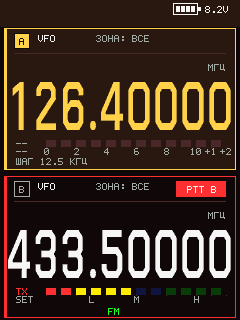

# UV98 Rust

> **ПРЕ-АЛЬФА — экспериментальная прошивка и CPS.** Проект находится на очень ранней стадии, ещё до альфа-версии. Возможны ошибки, потеря работоспособности и повреждение станции. Решение об установке и всё использование — полностью на ваш страх и риск. ПО предоставляется как есть, без гарантий; авторы не несут ответственности за ущерб или убытки в соответствии с условиями лицензии. До установки прочитайте лицензию и инструкции резервирования и возврата на сток.

**Прошивка на Rust и Windows CPS для платформы iRadio UV-98 Plus / RT-880.**

Независимые A/B, цветной спектр, инструменты КВ-приёмника и доступные исходники.

[English](README.md) · [Deutsch](README.de.md) · **Русский**

[**Бинарник прошивки**](https://github.com/YaziAranea/uv98-rust/releases/download/r37/UV98-r37.bin) · [**Комплект с CPS 0.7.0**](https://github.com/YaziAranea/uv98-rust/releases/download/r37/UV98-r37-CPS-0.7.0-2026-11-16.zip) · [**Начать здесь: бэкап и установка**](docs/GETTING-STARTED.ru.md) · [Описание выпуска](https://github.com/YaziAranea/uv98-rust/releases/tag/r37)

> **Экспериментальная прошивка для исследованного профиля платы AT32F423.** R37 — шаблон: перед записью подготовьте в CPS персональный образ по проверенному NOR-бэкапу своей станции. Это привязывает прошивку к вашим калибровкам и не заменяет заводские данные. Похожее название модели не подтверждает совместимость платы. Начните с [инструкции резервирования и подготовки](docs/GETTING-STARTED.ru.md#4-проверьте-совместимость-перед-прошивкой).

## CPS 0.7.0 для Windows

В списке **Язык / Language / Sprache** на панели выберите **Русский**, **English** или **Deutsch**. Все восемь вкладок и уже показанные сообщения меняют язык сразу. Несохранённые правки остаются в формах, а выбор языка запоминается в профиле Windows. Заголовки и фильтры файловых диалогов следуют языку CPS, стандартные кнопки — языку Windows.

В комплекте тот же BIN прошивки R37. Для обновления CPS перепрошивка не требуется. [Исходники CPS 0.7.0](https://github.com/YaziAranea/uv98-rust/tree/cps-v0.7.0)

*Интерфейс CPS отрисован через egui без окна Windows на имитационных данных.*

## Как выглядит интерфейс

<table>
<tr>
<td align="center"> <b>Каналы и VFO A/B</b></td>
<td align="center"> <b>Спектр и водопад</b></td>
</tr>
<tr>
<td align="center"> <b>Инструменты КВ</b></td>
<td align="center"> <b>Русский · English · Deutsch</b></td>
</tr>
<tr>
<td align="center"> <b>PTT B при выбранной строке A</b></td>
<td align="center"> <b>Низкий заряд</b></td>
</tr>
</table>

*Это кадры симулятора, использующего тот же Rust-рендерер, что и рация. Сигналы и показания на иллюстрациях смоделированы; это не результаты измерений эфира.*

## Новое в R37

- По умолчанию верхняя PTT запрашивает передачу по A, нижняя по B. На передающей карточке появляется TX. Если выбрана строка A, нижняя PTT сохраняет выбор A и использует частоту передачи, тон и текущую мощность B. Мощность задаётся отдельно для A и B в RAM, после включения обе стоят на LOW. Привязка нижней PTT выведена из схемы и архивных замеров ADC. Проверка R37 на рации открыта. [Данные по PTT](research/r37/ptt.md)
- Значок батареи показывает примерный уровень четырьмя делениями, рядом — напряжение цифрами (`--.-V`, если показание недоступно). Основа — заводской пересчёт ADC с шагом 0,1 В. Точность напряжения и пороги предстоит проверить на рации.
- При смене выбранного пункта внутри страницы меню тест рендера отправляет на LCD 15 строк вместо 67. Для этого действия объём передачи пикселей сократился примерно на 78%. FPS на рации не измеряли.

## Что есть в проекте

| Раздел | Возможности |
|---|---|
| Повседневная работа | Независимые канальный/VFO-режимы A/B, зоны, репитерный сдвиг, индикация CTCSS/DCS, сегментные S-метры и назначаемые клавиши. |
| Поиск сигналов | Сканирование частот, курсор и перемещение окна спектра, прослушивание пика, цветной водопад. |
| КВ | Si4732, управление AM/USB/LSB/CW, выбор диапазона и шага, последовательный RSSI-водопад, AM-фильтры и soft mute. |
| Сигналинг | DTMF с клавиатуры при удержании PTT; пятизначный ID ZVEI1/CCIR в конце передачи. |
| Навигация | Обработка GPS-позиции и ручной APRS-маяк через поддерживаемый C-BUS модем. |
| CPS для Windows | Каналы и зоны, резервирование калибровок/NOR, настройки GPS/APRS в файле, проверка BIN и запись через штатный загрузчик. |
| Языки | Документация и выбираемый интерфейс рации на русском, английском и немецком. Названия каналов остаются пользовательскими. |

Штатный режим «800 МГц» начинается **с 840 МГц**; пресет выбирает 850.000 МГц. Пресет CB — 27.135 МГц. В AM на CB доступен приём; AM-передача не добавлена.

## Сначала резервная копия

1. Оставьте стоковую прошивку и сохраните исходный `.880dmf` / `.98pdmf` своей станции.
2. Через нашу CPS считайте **калибровки**, **4 МиБ NOR** и **секции настроек/каналов**. Каждая операция читает данные дважды и сравнивает их.
3. Сохраните целые папки снимков и подходящий заводской BIN в двух местах. Публичный комплект не содержит прошивку производителя.
4. Проверьте совместимость платы, затем подготовьте в CPS персональный R37 по проверенному снимку NOR. Компилятор Rust для этого не нужен.

В [пошаговой инструкции](docs/GETTING-STARTED.ru.md) указаны кнопки CPS, ожидаемые файлы, проверка результата и откат. **Дамп NOR 4 МиБ не содержит прошивку MCU и загрузчик.**

## Текущие границы

R33 остаётся принятой владельцем опорной версией на рации. Аппаратная проверка R37 впереди. Результаты сборки и симуляции приведены в [описании выпуска](https://github.com/YaziAranea/uv98-rust/releases/tag/r37).

- Dual Watch поочерёдно слушает A/B. Одновременного звука двух BK4819 нет.
- КВ-водопад перестраивает единственный Si4732 и прерывает звук на время обзора. Это не FFT.
- APRS пока ручной: приём сообщений в интерфейсе, автомаяк и альтернативный GPIO-модем не закончены.
- Есть AM-фильтры и soft mute; полноценный NR/NB голоса основного BK4819 не реализован.
- Настройки рации, включая язык, пока находятся в RAM и сбрасываются после выключения. Редактор CPS ещё не является USB-протоколом записи настроек Rust-прошивки.

## Исходники и разработка

| Каталог | Содержимое |
|---|---|
| [`firmware-diagnostic/`](firmware-diagnostic/) | Исполняемая прошивка и основной цикл рации. |
| [`crates/`](crates/) | Драйверы, интерпретация калибровок, RF runtime, UI и сигналинг. |
| [`apps/cps/`](apps/cps/) | Исходники Windows CPS. |
| [`apps/handheld-image-sim/`](apps/handheld-image-sim/) | Симулятор экранов с общим рендерером. |
| [`research/`](research/) | Аппаратные основания и исследования протоколов. |

[Как собрать](BUILDING.md) · [Участие в проекте](CONTRIBUTING.md) · [Состояние проекта после R37](HANDOFF-R37.md) · [Требования и наблюдения](FEATURES-NEXT-RU.txt) · [Что добавить дальше](docs/NEXT-FEATURES.ru.md) · [Приватные входы](PRIVATE-INPUTS.md)

Личные калибровки, NOR и codeplug не публикуются. Часть проверок требует оригинального приватного fixture — это описано в инструкции сборки. Собственные код и документация проекта распространяются по [лицензии MIT](LICENSE); сторонние файлы сохраняют [свои лицензии и авторство](THIRD-PARTY-NOTICES.md).

Для сообщения об ошибке укажите выпуск и SHA BIN, модель/плату, точные действия, ожидаемый и фактический результат; приложите фото нужного экрана. Не выкладывайте в публичный issue полный NOR, личный codeplug и журналы координат.
